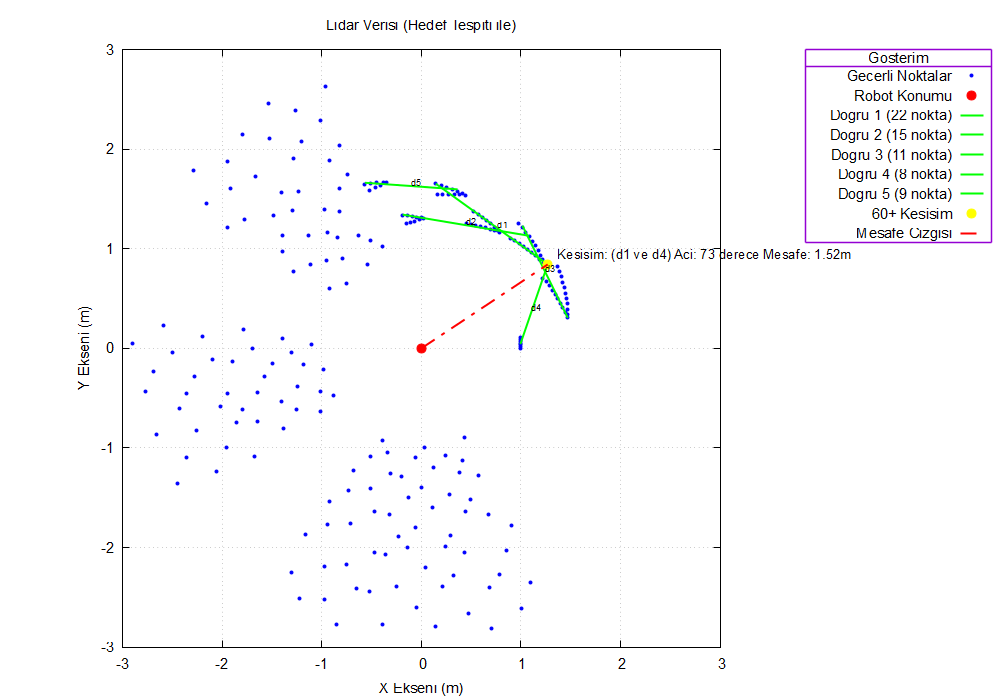

# LIDAR ile Doğru ve Hedef Köşe Tespiti

2D LIDAR taramasındaki gürültülü noktalardan duvar benzeri **doğruları** bulan, bu doğruların
**60° ve üzeri açıyla kesiştiği köşeleri** tespit eden ve robota en yakın köşeye olan mesafeyi
hesaplayan bir C++ programı. Mobil bir robotun şarj istasyonu gibi bir hedefe yanaşması için
gereken geometrik adımları uygular.

> **EN —** A C++ program that extracts wall-like line segments from a noisy 2D LIDAR scan
> (RANSAC + least-squares refinement), finds corners where two lines meet at 60° or more, and
> reports the distance from the robot to the nearest one, with a Gnuplot visualization.
> Standard library only, no dependencies.



- **Dil:** C++14 — yalnızca standart kütüphane, ek paket kurulumu gerekmez
- **Görselleştirme:** Gnuplot (kurulu değilse program yine çalışır, sadece grafiği açmaz)
- **Girdi:** TOML biçiminde LIDAR taraması; örnek dosya repoda
- **Yöntemler:** RANSAC, en küçük kareler, doğru kesişimi ve açı hesabı

Geliştiren: Enes Canlı

## Öne çıkanlar

- **Gürültüye dayanıklı doğru tespiti.** Rastgele nokta çiftlerinden 3000 aday doğru üretilir,
  en çok noktanın 2 cm yakınından geçtiği seçilir. Gürültü noktaları hiçbir doğruyu yeterince
  desteklemediği için kendiliğinden elenir.
- **Uzak duvarlar tek doğru sayılmaz.** Aynı doğrultudaki noktalar sıralanır, aralarında 1 m'den
  büyük boşluk olan yerlerden ayrı parçalara bölünür.
- **İki aşamalı iyileştirme.** Rastgele iki noktadan kurulan model, önce tüm destekçi noktalarla,
  sonra her parça kendi noktalarıyla en küçük kareler yöntemiyle yeniden hesaplanır.
- **Kütüphanesiz TOML okuyucu.** Parametreler ve birden fazla satıra yayılan `ranges` dizisi elle
  yazılmış küçük bir ayrıştırıcıyla okunur; `nan` değerler tanınır.
- **Tekrarlanabilir sonuç.** Yerel dosyayla çalışırken rastgele sayı üreteci sabit tohumla
  (`srand(1)`) başlar; aynı girdi her seferinde aynı doğruları ve hedefi verir.

## Çalıştırma

### Derleme

```bash
g++ -std=c++14 -O2 -o lidar_dogru_tespit src/lidar_dogru_tespit.cpp
```

### Çalıştırma

Komutlar repo kök klasöründe çalıştırılır.

```bash
./lidar_dogru_tespit                 # örnek veri: ornek-veri/scan_data_NaN.toml
./lidar_dogru_tespit tarama.toml     # kendi tarama dosyan
./lidar_dogru_tespit --sunum         # sunucudan rastgele bir tarama indirir (curl gerekir)
```

Örnek veriyle beklenen sonuç:

```
Tespit Edilen Dogru Sayisi: 5
Robota en yakin 60+ derece hedef bulundu.
  Koordinat: (1.26925, 0.842981)
  Mesafe: 1.52368 metre
  Aci: 73.1526 derece
```

Sunum modunun veri çektiği üniversite sunucusu artık erişime kapalıdır (HTTP 403). İndirme
başarısız olursa program örnek veriyle devam eder.

## Dosya biçimleri

Girdi dosyası TOML biçimindedir. Açılar radyan, mesafeler metre cinsindendir:

```toml
[scan]
angle_min = 0.0
angle_max = 4.71238898
angle_increment = 0.0174533
range_min = 0.2
range_max = 3.0
ranges = [ 1.0, 1.0, nan, 1.5, ... ]
```

Program çalıştığı klasöre şu dosyaları yazar ve sonunda `gnuplot -p plot_script.gp` ile grafiği
açar. Bu dosyalar her çalıştırmada yeniden üretildiği için repoya eklenmez.

| Dosya | İçerik |
|---|---|
| `points.dat` | Geçerli tüm ölçümlerin kartezyen koordinatları |
| `robot.dat` | Robot konumu (orijin) |
| `dogru_N.dat` | Her doğrunun iki uç noktası |
| `hedef_nokta.dat`, `mesafe_cizgisi.dat` | Seçilen köşe ve robotla arasındaki çizgi |
| `plot_script.gp` | Hepsini çizen Gnuplot betiği |

## İşlem adımları

1. **Okuma:** TOML dosyasından açı/mesafe parametreleri ve `ranges` dizisi okunur.
2. **Filtreleme ve dönüşüm:** `NaN` ve `range_min`–`range_max` dışındaki ölçümler elenir; kalanlar
   $(r, \theta)$ kutupsal değerlerden $(x, y)$ noktalarına çevrilir.
3. **RANSAC:** En az 8 noktanın desteklediği doğru bulunur, parçalara ayrılır, kabul edilen
   parçaların noktaları listeden çıkarılır. Doğru kalmayana kadar (en fazla 10) tekrarlanır.
4. **Kesişim analizi:** Her doğru çiftinin kesişim noktası ve aradaki açı hesaplanır. 60° ve üzeri
   kesişimlerden robota en yakın olanı hedef seçilir.
5. **Görselleştirme:** Sonuçlar `.dat` dosyalarına yazılır, Gnuplot betiği üretilip açılır.

## Parametreler

`src/lidar_dogru_tespit.cpp` içindeki sabitler:

| Sabit | Değer | Anlamı |
|---|---|---|
| `UZAKLIK_TOLERANSI` | 0,02 m | Noktanın doğruya ait sayılması için en fazla uzaklık |
| `MIN_DESTEKCI_SAYISI` | 8 | Bir doğrunun kabul edilmesi için gereken en az nokta |
| `ITERASYON_SAYISI` | 3000 | Her doğru için denenen rastgele aday sayısı |
| `MAX_NOKTA_ARASI_MESAFE` | 1,0 m | Aynı parçadaki ardışık iki nokta arasındaki en fazla boşluk |
| `MAX_DOGRU_SAYISI` | 10 | Aranacak en fazla doğru sayısı |
| `MIN_KESISIM_ACISI` | 60° | Hedef sayılması için en küçük kesişim açısı |
| `RANSAC_MIN_MESAFESI` | 0,5 m | Robota bundan yakın noktalar doğru aramaya katılmaz |

## Klasör yapısı

| Yol | İçerik |
|---|---|
| `src/lidar_dogru_tespit.cpp` | Programın tamamı: okuma, filtreleme, RANSAC, kesişim analizi, Gnuplot çıktısı |
| `ornek-veri/scan_data_NaN.toml` | Gürültü, `NaN` ve aralık dışı değerler içeren örnek tarama |
| `docs/` | README görseli |

## Uç durumlarda verilen kararlar

1. Robota 0,5 m'den yakın noktalar grafikte gösterilir ama doğru aramaya katılmaz.
2. Noktaların x yönündeki yayılımı 1 cm'den azsa doğru dikey kabul edilir ve `x = sabit` olarak
   saklanır; eğim/kesişim hesapları bu durumu ayrıca ele alır.
3. Eğimleri arasındaki fark 0,0001'den küçük olan doğrular paralel sayılır, kesişim aranmaz.
4. Birden fazla 60°+ kesişim varsa robota (orijine) en yakın olan seçilir.
5. Uygun kesişim bulunamazsa program bunu bildirir; grafik hedef ve mesafe çizgisi olmadan çizilir.
6. Sunum modunda indirme başarısız olursa örnek veriyle devam edilir.

## Bilinen sınırlamalar

- Kesişimler doğruların sonsuz uzantıları üzerinden hesaplanır. İki doğru parçası gerçekte
  birbirine uzak olsa bile uzantıları 60° ile kesişiyorsa hedef sayılabilir.
- `ranges` dizisinin eleman sayısının açı parametreleriyle tutarlı olup olmadığı kontrol edilmez.

## Lisans

MIT
